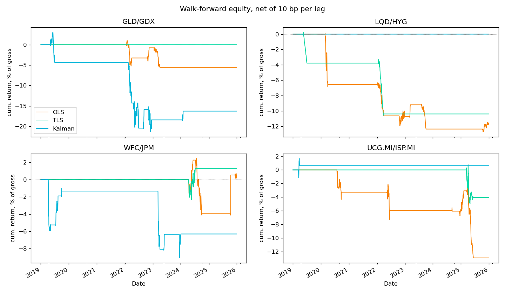

# Pairs Trading — Statistical Arbitrage Framework

Cointegration-based pairs trading with OU signals and a walk-forward backtest comparing OLS, TLS and Kalman hedge ratios.

Write-up: [hajar6883.github.io/work/releases/pairs](https://hajar6883.github.io/work/releases/pairs/)



## Setup

Python ≥ 3.10. Run everything from the repo root.

```bash
git clone https://github.com/hajar6883/pair_trading.git
cd pair_trading
pip install -r requirements.txt
```

## Usage

```bash
# All pairs × all hedge methods, cost sensitivity → results/results.md, results/equity.png
python3 scripts/results.py

# OLS vs TLS vs Kalman on one pair (interactive Plotly chart)
python3 scripts/kalman_analysis.py --t1 GLD --t2 GDX
python3 scripts/kalman_analysis.py --t1 LQD --t2 HYG --start 2018-01-01 --end 2026-01-01 --W 1e-6

# In-sample vs walk-forward on one pair
python3 scripts/run_backtest.py

# Screen ~60 tickers across 12 sectors for cointegrated pairs → pair_screener_results.csv
python3 scripts/find_pairs.py
```

`kalman_analysis.py` options:

| Flag | Default | |
|---|---|---|
| `--t1`, `--t2` | `GLD`, `GDX` | tickers (yfinance symbols) |
| `--start`, `--end` | `2020-01-01`, `2026-01-01` | date range |
| `--train`, `--test` | `252`, `63` | walk-forward window lengths (days) |
| `--W` | `1e-5` | Kalman state noise variance |

## Tests

```bash
python3 -m pytest tests
```

## Structure

```
data/         fetch.py           yfinance download
spread/       OU_process.py      OU fit (AR(1))
              hedge_ratio.py     OLS, TLS
              kalman.py          Kalman hedge ratio
              stat_tests.py      ADF, Hurst
signals/      signal.py          entry ±2σ / exit 0 / stop ±3σ
backtest/     walk_forward.py    rolling walk-forward
              engine.py          in-sample backtest
evaluation/   metrics.py         Sharpe, drawdown, win rate
scripts/                         entry points (above)
tests/                           pytest suite
results/                         generated tables and plots
```
